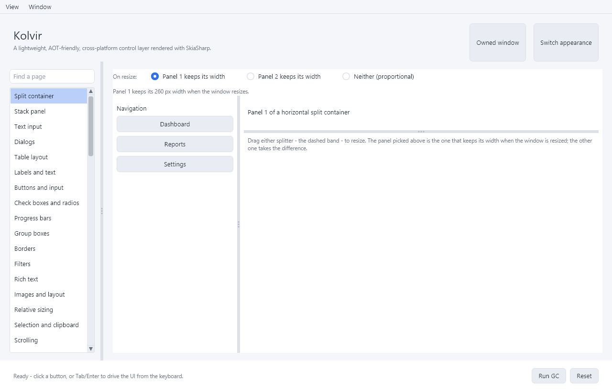

# How the pieces fit together

An application is one `Application`, one or more `Window`s, and a tree of controls inside each
window. The window is a surface the operating system owns; everything drawn on it is Kolvir's.

## The objects

| Object | What it is |
| --- | --- |
| `Application` | The run loop, the services, the palette and the open windows. One per process. |
| `Window` | A top-level window: a title, a client size, a content control, and a place in the platform's window list. |
| `Control` | Everything drawn inside a window. Any control can hold children, so a window's content is a tree. |
| `UiHost` | The thing inside a window that lays the tree out, paints it, routes input to it and tracks the focus. `window.Host` is it. |
| Services | The container `Application` builds from `ApplicationOptions.ConfigureServices`, plus the services Kolvir registers: dialogs, popups, the clipboard. |

Your code never talks to the platform. A window's title bar, its input, the clipboard, the system
dialogs and the light or dark appearance arrive through the integration that `KolvirBackend`
supplies, which is why the same program runs on each system.



## Starting an application

```csharp
using var application = new Application(KolvirBackend.CreateDefault(), new ApplicationOptions
{
    ApplicationName = "Notes",
    ConfigureServices = services => services.AddAnimations().AddDragDrop(),
});
```

The options are read when the application starts, so set them there rather than later. Everything a
feature needs is registered in `ConfigureServices`; leaving a feature out keeps it out of your
application, and the `Add...` calls are the whole of the opt-in.

## The window and its tree

```csharp
var save = new Button("Save") { Dock = DockStyle.Bottom, Height = 40f };

var window = new Window("Notes", new StackPanel
{
    Padding = new Thickness(16f),
    Spacing = 8f,
    Controls =
    {
        new Label("Nothing to save yet.") { WrapText = true },
        save,
    },
})
{
    ClientSize = new SKSize(640f, 420f),
};

save.AddClickHandler(_ => Console.WriteLine("saved"));
```

A control does not need a name to be reached: the variable you built it into is the one your handlers
close over. `Control.Id` exists for the cases where something outside the building code looks a
control up, and `window.TryGetControlById` is that lookup.

Every control has the same base features: a position and size, `Margin` and `Padding`, `Dock`,
`Visible` and `Enabled`/`EffectiveEnabled` (a disabled container disables everything inside it), an
inherited font and foreground colour, the focus, and notifications. Those notifications are not C# events: each is a pair
of `Add...Handler` and `Remove...Handler` methods, and the `Add` call returns a token that
unsubscribes when it is disposed:

```csharp
IDisposable subscription = save.AddClickHandler(_ => Console.WriteLine("saved again"));
subscription.Dispose();
```

## Lifetime

| Step | What happens |
| --- | --- |
| `window.Show()` | The window becomes visible; the tree is laid out and painted for the first time. |
| `application.Run()` | Runs until the application exits, then returns `application.ExitCode`. |
| The last window closes | The application exits, unless `ApplicationOptions.ShutdownMode` says otherwise. |
| `application.Exit()` | Asks the run loop to stop; windows close. |
| `application.Dispose()` | Releases the services and the platform integration. `using` on the application does this for you. |

A window that was never shown is laid out when it is shown, not before, so a control's measured size
is not final until then. `Window.IsShown` and `Window.IsClosed` answer where a window is in that
sequence.

## Services

Everything `ConfigureServices` registers is reachable from `application.Services`, and a window has
its own scope at `window.Services` for anything that belongs to one window:

```csharp
var clock = window.Services.GetService(typeof(IClock)) as IClock;
Console.WriteLine(clock is null ? "no clock registered" : "clock ready");
```

The system dialogs are behind `application.Dialogs`: `ShowMessage`, `OpenFile`, `SaveFile`,
`PickFolder` and `PickFont`. Each takes the window it belongs to, so a modal dialog is owned by the
window in front of it.

## Threading

Everything that touches a control runs on the thread that called `Run`, and handlers are called on
that thread. From anywhere else, marshal back:

| From a worker | What it does |
| --- | --- |
| `application.Invoke(action)` | Runs the action on the UI thread and waits for it. |
| `application.BeginInvoke(action)` | Queues the action for the UI thread and returns. |
| `application.CheckAccess()` | True when the caller is already on the UI thread. |

## Asking what the system supports

Some window features are not available everywhere, and the library reports which ones it has instead
of letting a request fail silently:

```csharp
if (window.ChromeCapabilities.Borderless)
{
    window.Chrome = WindowChrome.Borderless;
    window.CaptionButtons = CaptionButtons.Platform;
}
```

`Window.ChromeCapabilities` answers for the window in front of you, which is the answer to trust: it
can differ between two versions of the same operating system. What each system supports is also
listed in the [platform matrix](../reference/platform-matrix.md).

## Where to go next

- The control reference, one page per control: [Control](../reference/controls/control.md) is the
  base every other control page inherits its members from.
- [Your first window](../getting-started/first-window.md) if you have not built one yet.
