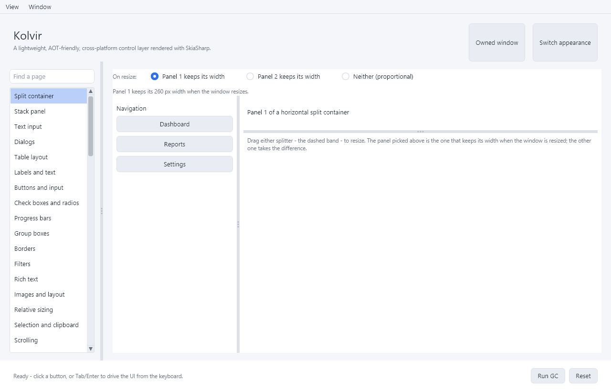

# Kolvir

Kolvir is a UI library for .NET. You describe a window and its controls in C#, and Kolvir draws them
itself; the operating system supplies the window, the input and the system dialogs. One control tree
runs unchanged on Windows, macOS and Linux, and the same tree can be rendered to a PNG with no window
at all.



## Is Kolvir for you?

Choose Kolvir when:

- you want one control tree for Windows, macOS and Linux, with no per-OS code in your application;
- you like the WinForms programming model: `Dock`, `Margin`, `TabIndex`, `Add...Handler` subscriptions;
- you publish NativeAOT and want no reflection in your UI layer;
- you want to render the same UI to a file, for tests or for documentation.

Choose something else when:

- you want XAML, data binding, styles or a visual designer;
- you need the platform's own controls inside your window - Kolvir draws its controls;
- you need an API that will not change: Kolvir is pre-1.0.

## What you get

- **Controls.** Label, RichLabel, Button, CheckBox, RadioButton, ProgressBar, TextBox (single- and
  multi-line, with undo, spans and autocomplete), ListBox, ListView, TreeView, ComboBox, TabControl,
  GroupBox, TrackBar, NumericUpDown, DateTimePicker, LinkLabel, ColorPicker, ToolTip, SplitButton,
  Expander, ToolStrip, Toast, BusyIndicator, Overlay, Image, menus and the common dialogs.
- **Layout.** Docking, a table layout with attached cells, a stack panel, a wrap panel, a split
  container that drags, and scrolling.
- **Text.** Selection, the clipboard, spans and web fonts.
- **One palette**, with a light and a dark presentation, that every control paints from.
- **Images.** Bitmaps, SVG, animated GIF and animated WebP behind one format seam, so
  `Images.LoadFromStream` reads whichever it is handed.
- **Separate packages** for the features that cost native code, so an application pays for what it
  uses: drag and drop, animations, app badging, audio, SVG, animated GIF, animated WebP, web fonts,
  a virtual DOM and observables.

## Three ways in

1. [Install Kolvir](getting-started/install.md), then build [your first window](getting-started/first-window.md).
2. Read [how the pieces fit together](concepts/architecture.md) before you write much code.
3. Run the sample, which has a page for almost every control and feature:

   ```bash
   dotnet run --project src/demo/Kolvir.Demo.App
   ```

The control reference is generated from the library's own documentation, one page per control -
[Button](reference/controls/button.md), [ListBox](reference/controls/list-box.md),
[SplitContainer](reference/controls/split-container.md) and the rest. What each operating system
supports is in the [platform matrix](reference/platform-matrix.md).

## Versions

Kolvir is pre-1.0: the API is still settling, and a minor version may change it. The packages are
published to this repository's GitHub Packages feed rather than to nuget.org, which
[Install](getting-started/install.md) covers.

## Working on Kolvir itself

This guide is for applications built with Kolvir. The design documents, the implementation guide and
the testing runbook for the library itself are in `dev-docs/` in the repository.
